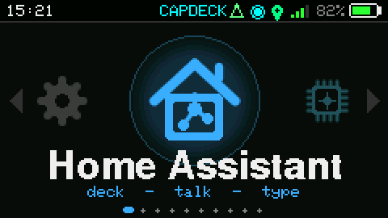
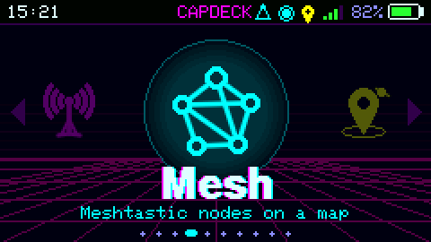

# CapDeck — custom firmware for the M5Stack Cardputer ADV

 

A hacker's pocket deck with a fungal soul. Sixteen apps on a Bruce-style icon carousel, living wallpapers,
a real power chain that saves your battery, and a Wi-Fi portal so you can set it all up from your phone.
Simple by default, deeply hackable underneath. Every odd name has a plain label next to it.

**Current version: 2.0.0** · [Changelog](CHANGELOG.md) · firmware + SD kits in [Releases](../../releases)

| App | What it does |
|-----|--------------|
| **Home Assistant** | Button deck with live states, **push-to-talk Assist** (hold SPACE or G0), typed Assist chat |
| **Macros** | One tap fires a whole chain: HA + IR + RF + LoRa + waits, from `/capdeck/macros.json` |
| **Local AI** | Chat with your own model (Ollama, LM Studio, llama.cpp). Built-in setup guide |
| **Mycorrhiza** · downloads & lookups | DuckDuckGo + Wikipedia answers; download a city's roads for the Map; any remote from Flipper-IRDB on demand; ISS orbit data for Nightcap |
| **LoRaWAN** (it becomes *LoRaMAN*) | CapDeck-to-CapDeck chat, packet monitor, ping, spectrum + waterfall, activity hunter. **US 915 or EU 868** |
| **Mycelium** · Meshtastic | Nodes heard, public messages, Find-the-mesh, optional sending (Client-Mute, off by default) |
| **Rhizomorph** · Reticulum radio | Turns the Cardputer + Cap into an **RNode for Sideband** over Bluetooth LE. *Experimental* |
| **Forage** · collect spores | Passive Wi-Fi / Bluetooth / mesh logging; every find is a mushroom; WiGLE "Spore print" export |
| **Map** | One map, toggleable layers: roads drawn as mycelial threads, plus nodes and finds as dots |
| **Nightcap** · the sky above you | Live planetarium: stars, constellations, planets as their classical glyphs, the real Moon phase, GPS satellites as Tracers, the ISS with pass chimes |
| **GPS** | Fix, real satellite radar from the module's own data, waypoints to CSV; sets the clock |
| **Infrared** | Flipper `.ir` remotes; search ~9,000 and download any one on demand |
| **RF 433** | Decodes fixed-code remotes from an RX470C, logic scope, saved codes, forward to HA, replay |
| **Portal** | The Cardputer's own hotspot + phone web app: AI chat, config editor, SD file manager, mesh nodes |
| **Files** | SD browser: view any text file, **view images** (PNG/JPG/BMP), **edit `.json` with validation**, **launch another firmware `.bin`** |
| **Config** | Theme, power, Wi-Fi, display, sound, LED, system info, back to M5Launcher |

Hardware: Cardputer ADV. The Cap LoRa-1262 (LoRa + GPS) is needed for LoRaWAN, Mycelium, Rhizomorph, GPS and
the position side of Forage, Map and Nightcap. Everything else works without it.

## Themes

Every theme is alive, one colour each: **Spore** (mycelium threads and drifting spores, the default), Spore Light,
**Matrix** (digital rain), Ocean, Lava, Amber (CRT terminal), Storm, Cyber, Aurora, Abyss, Void. At the bottom of
the picker, **Still life** freezes the wallpapers into plain colours. A low battery does that by itself.

## Power

**Dim → Doze → Spore mode.** After the screen timeout it dims, then dozes: screen and radios off, light sleep, and
it wakes in a second with your app right where you left it. After a long doze (30 min by default) it drops into
Spore mode (deep sleep). **Wake key:** Enter by default; Any key or Fn+Enter in Config > Power. Apps doing real
work (Mycelium listening, Forage, Rhizomorph, charging) keep the radios up. Tweak the details in Config > Power.

## Install

**M5Launcher (keeps your launcher):**
1. Download an SD kit from [Releases](../../releases) and unzip it onto the root of the microSD card:
   - **Lite** (~1 MB): `CapDeck.bin`, config template and folders. Remotes download on demand.
   - **Full** (~21 MB): Lite plus the whole Flipper-IRDB remote library.
2. In M5Launcher, install `CapDeck.bin` from the SD card.

Updating? Just replace `CapDeck.bin`; CapDeck adds any new folders and files it needs and never overwrites yours.

**Full flash (M5Burner / esptool / web flasher):** flash `firmware/CapDeck-v2.0.0-full-0x0.bin` at address `0x0`.
This replaces whatever was on the device, M5Launcher included.

The first boot runs a short setup wizard (theme, tips, Wi-Fi, Mycelium).

## Set it up from your phone (no SD swapping)

1. On the Cardputer, open **Portal** and press **ENTER**.
2. Scan the QR code with your phone (or join `CapDeck-XXXX`, default password `deathcaps`; press **P** to set your
   own). The control panel opens on its own, or go to `http://192.168.4.1`.
3. **Config** tab: fill in your Wi-Fi, Home Assistant URL + token, and local AI server, then tap *Save & reload*.
4. **Files** tab: upload `.ir` remotes, map tiles, and so on.

## Config reference (`/capdeck/config.json`)

```json
"wifi": [ { "ssid": "YourNetwork", "pass": "YourPassword" } ],
"home_assistant": { "url": "http://192.168.1.50:8123", "token": "...", "tts_engine": "tts.piper" },
"local_ai": { "url": "http://192.168.1.60:11434", "model": "", "system": "Keep replies short." },
"ha_buttons": [ { "name": "Bedroom lights", "service": "light.toggle", "entity": "light.bedroom" } ],
"lora": { "freq_mhz": 915.0, "bw_khz": 125.0, "sf": 9, "cr": 7, "sync_word": 18, "power_dbm": 17 }
```

You can edit it right on the device: Files > `config.json` > Edit (JSON). It won't save a file that isn't valid JSON.

## Radio band (US 915 / EU 868)

LoRaWAN > Radio settings > **Band**. Fit the antenna for that band before transmitting.

* **US 915:** 902–928 MHz. Mycelium uses Meshtastic's US slot for the chosen preset (LongFast = 906.875 MHz).
* **EU 868:** 863–870 MHz. Mycelium uses Meshtastic's EU sub-band (869.4–869.65 MHz): 869.525 MHz for the 250 kHz
  presets, 869.4625 for LongSlow, 869.5875 for LongMod. The 500 kHz Turbo presets don't fit there and are hidden.
  The scanner sweeps 860–886 MHz. The EU duty-cycle limit isn't enforced, so keep transmissions short.

## Rhizomorph (Reticulum / Sideband) — experimental

1. Open Rhizomorph and keep it on screen. It shows a name (`RNode XXXX`) and a 6-digit PIN.
2. On your phone, pair with that name in Bluetooth settings and type the PIN.
3. In Sideband: Connectivity > Connect via RNode, enable Bluetooth, and set frequency, bandwidth, SF, coding
   rate and TX power (the same as the people you want to reach).
4. Start the RNode interface. The top line turns to `tethered`.

While it's open, Mycelium is paused (one radio, one network). The screen can sleep; it keeps relaying.
It's written from Reticulum's published host code, so the protocol matches. It has **not yet been tested against
Sideband on real hardware**. Please report how it goes.

## Meshtastic (Mycelium) notes

Listening is off until you turn it on (the setup wizard asks). **Find the mesh** shows which preset nearby nodes use.
Packets on the public default channel are decoded (names, positions, public texts); add your own channels under
`mesh_channels` in `config.json`. Private channels and DMs only show the sender.

Sending is **off by default**. When enabled it uses the Client-Mute role: your own text, node info and position only,
never rebroadcasting anyone else's packets. Test it on a private channel first.

## Map

Mycorrhiza > Map regions > Add a place: type a city and it downloads that area's major roads from OpenStreetMap
(Nominatim + Overpass), simplified to a small file. Map then draws them as glowing threads, with Mycelium nodes
and Forage finds on top. **L** toggles layers, **Fn+arrows** pan, **-/=** zoom, **TAB** steps through what's on
screen, **M** recentres on you. Optional raster tiles go in `/capdeck/map/tiles/<z>/<x>/<y>.png`.
Map data © OpenStreetMap contributors.

## Keys

`;` `.` up/down · `,` `/` left/right · **ENTER** or **G0** select · **DEL** back · `1`–`9`, `0` jump ·
chats: **Fn+;/Fn+.** scroll · **`** cancels text entry.

## 433 MHz wiring (RX470C → Grove)

GND → black, VCC → red (5 V), DATA → white (G1) **through a divider** (DATA —10 kΩ— G1 —20 kΩ— GND). The ESP32-S3
pins only take 3.3 V.

## Building

See [CLAUDE.md](CLAUDE.md) for the exact toolchain, library versions and build command.

## Credits & license

CapDeck is written by **doot-noot** (Deathcaps) with **Claude** (Anthropic) as an AI coding assistant. See
[CHANGELOG.md](CHANGELOG.md) for how each release was made. CapDeck's own code is MIT-licensed ([LICENSE](LICENSE)).
It builds on open-source libraries listed in [THIRD_PARTY_NOTICES.md](THIRD_PARTY_NOTICES.md). Rhizomorph is our own
implementation of the documented RNode protocol (no RNode firmware code is included). Flipper-IRDB is CC0 (commits
before 2319685 aren't covered by that dedication). Map data © OpenStreetMap contributors (ODbL).

Use the radio features only on your own devices and within your local rules.
